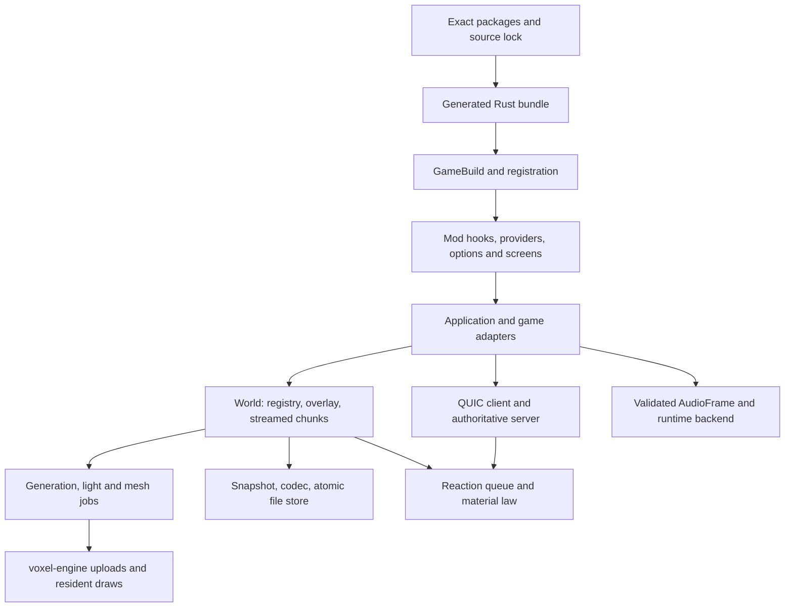

<!-- SPDX-FileCopyrightText: 2026 Project Watt Cubed contributors -->
<!-- SPDX-License-Identifier: CC-BY-SA-4.0 -->

# Architecture, vision and the current boundaries

## The vision being used for this review

The owner's instruction is the governing direction: a hyper-optimized voxel framework supplies
the necessities; native mods compiled into the binary supply any aspect of the experience that
someone might reasonably want to change. Simplicity, freedom, community and exploration in
[philosophy.md](../../../documentation/philosophy.md) and [IDEA.md](../../../documentation/IDEA.md)
support that direction. Efficiency takes precedence over convenience, but a small composable
mechanism is more valuable than a fast special case repeated throughout the codebase.

That gives a useful core test: **is this an invariant/mechanism needed by consumers, or a choice
of experience?** Coordinate identity, conserving matter, bounded work, authoritative commits,
storage, transport and drawing machinery belong in mechanisms. Which menus, texture style,
generation algorithm, world appearance, interaction rules and content to use should have
replacement points. Existing matter documentation deliberately fixes one law in the core; that
is a declared design choice, not a defect simply because other games choose differently.

## The three-repository system

| Part | Current responsibility | Important boundary |
| --- | --- | --- |
| This game | Runtime library, world storage/streaming, law integration, player, save/network/audio adapters, mod host | `run(GameBuild)` |
| `../voxel-engine` | Vulkan 1.3 renderer, window/input, packed vertices, GPU lifetime, presentation | Client consumes it; reusable domain/server code should not require it |
| `../pwc-package-manager` | Source packages, resolver, immutable store, instance locks, generated Rust bundle, build cache, first-party mods | Chooses exact packages; runtime receives a static package list |

The builder generates an instance and bundle containing the exact resolved packages. Cargo compiles
the game and their source together; the root release profile uses opt-level 3, fat LTO and one
codegen unit. The builder copies profiles into generated workspaces. A package's contents have
a hash, a lock has an environment identity, and build identity additionally includes source state,
compiler, profile and target. That is a strong basis for reproducibility and native performance.

There is no dynamic code loader. In the runtime, however, registration stores `Box<dyn Mod>` and
dispatches hooks through that collection. Native compilation does not by itself guarantee that
LLVM removes every virtual call or default no-op hook. This deserves measurement and a more
selective dispatch plan, not an assumption that compiled means statically dispatched.

## Data and execution flow

**Matter.** `crates/material` is a pure integer law over configurations of up to 32 occurrences
on a four-dimensional byte torus. Canonical encodings are the portable identity. `BlockId(u16)`
is a compact world-local intern index; the registry stores observations, kernel records,
presentation and hot structure-of-arrays tables. A material's hardness/light/acoustic properties
are derived, rather than declared by named block types. Conservation and byte determinism are
the important guarantees.

**World storage.** Chunks are 16³ cells, with uniform, paletted and dense representations.
The generated world is a pure baseline; a sparse overlay records differences. Streaming maintains
data and mesh lifecycles, epochs, worklists, coverage, near/far admission and resident GPU handles.
Worker jobs own snapshots and immutable tables, while the world retains authority over live
state. That ownership model is worth preserving during optimization.

**Space.** Physical points use f64 and live within ±1e9. Chart storage uses ordinary i32 voxel
addresses beyond the physical world, starting at x=1.1e9. Atlases embed round surfaces and warped
cubes into physical space; seams identify neighbors across storage boxes. Player movement and
raycasting transform into local storage frames. Rendering bends meshes through cages. Gravity
uses analytic generated mass plus exact integer edit corrections, evaluated with declared
approximation/error bounds. A subsystem that assumes an address is a physical point, or that
`x+1` is always the real neighbor, breaks this architecture (B02–B03).

**Generation.** The current released generator is worldgen 11: the emergent cosmos chooses
bodies, mineral suites, shapes and storage from the full seed. `crates/field` provides integer
Jacobi fields and exact-apron tiles; mechanics provides lattice/genesis/warp machinery. The
emergent-worldgen design document's later phases are a roadmap. Merely finding a `globe.rs` file
does not establish that every promised future geology/life/culture phase is shipped.

**Reactions.** A deterministic contact queue runs at 20 Hz with 384 attempts per turn. Changes
wake contacts; generation and loading do not. Connected clients do not evaluate reactions.
Pending work is saved. This is a small useful kernel, but pair commits and topology must be
correct before scaling its throughput.

**Multiplayer.** QUIC carries a seed/configuration and sparse canonical-spec edits, not whole
chunks. One state mutex owns the ledger and roster. Position interest uses a spatial grid and
20 Hz batched poses with a slower distant cadence. Per-connection readers/writers and bounded
outboxes make ownership understandable, but heavy generator/kernel work under the state lock
and thread-per-client costs limit scaling. Edit requests have revisions and optimistic rollback;
tool requests are server-evaluated and have weaker confirmation handling. The server currently
does not hold an authoritative inventory ledger.

**Persistence.** Save format 10 stores generator/law identity, player pose/velocity/inventory,
canonical spec table, overlay, mod state and pending contacts. A snapshot is captured on the
caller and encoding/periodic writes run off-thread. Files use a synced temporary file and
backup rotation. Read recovery exists, but recovery source is not carried through the
singleplayer writer (B11), and listing does not discover backup-only slots (B12).

**Audio.** Mods choose cue and voice policy; core service builds a validated owned `AudioFrame`;
runtime manages decode, voices, spatialization and device backends. The capture chain is SPSC,
with conversion and Opus off the realtime callback. The recording backend and pure acoustic
tests are valuable seams. The existing crate-boundary document already proposes a sensible
dependency direction; this audit agrees with its incremental approach.

## What is already replaceable

First-party packages outside this repo supply menus, settings/mod screens, hotbar/inventory
presentation, texture generation, material naming, sounds, proximity chat, commands, flight and
visual enablement. Options are indexed, persisted centrally, and unknown option lines are kept
when a package is removed. Packages register shared values and screen entries without naming
other packages in the host. Most mod hooks compose or arbitrate in a documented stable order.

These are real achievements toward the vision. Bugs in provider caches and persistence are
especially important because they undermine otherwise good seams.

## Where extensibility is still narrower than the vision

| Area | Current seam | Remaining restriction |
| --- | --- | --- |
| World generation | `Mod::worldgen()` selects `WorldgenKind` | Closed `Flat`/`Diffusion` enum; saves and Welcome use fixed kind/knob formats; no registered arbitrary factory |
| Authoritative gameplay | `ServerMod` validation/join/leave/chat hooks | No general mod simulation tick, transactional mutation context, or bundle-generated modded server executable |
| Machine edits | Public mutable `World` in client hooks | Direct writes bypass the game's network request/confirmation path; documented wake alone does not synchronize them |
| GUI | Replaceable screens; `UiElement`/`HudElement` data | Rectangles and fixed-font text; HUD role colors and panel styling are core-owned; no image/font/clip/pointer vocabulary for a substantially different GUI |
| Visual experience | Appearance/namer providers and `VisualGroup` bits | Groups enable existing render lanes; they do not define arbitrary new renderer integrations |
| Controls | Declared chords plus core bindings | Core bindings win clashes, no shipped rebinding surface, globally capped 128 mod actions |
| Matter/inventory | Core law and `Inventory` exposed to mods | One law is intentional; storage limits and capacity persistence constrain expanded holdings |
| API stability | `pwc-mod-api` re-exports runtime modules | Broad concrete types couple mods to changes in streaming/player/render implementations |

These are design work items, not all bugs. In particular, declaring trusted native mods and
runtime suspension is consistent with a compiled ecosystem. Suspension is cooperative hook
gating, not a security sandbox; a previously shared native handle can outlive it.

## Documentation decisions to settle

`MOD_POLICY.md` explicitly calls today's compiled-native model a temporary local stage before
an official sandboxed WebAssembly ABI. That future policy differs from the owner's stated
native-binary direction. It should be reconciled deliberately, rather than quietly designing
new APIs toward both incompatible assumptions. A review/signing system can verify source and
provenance while retaining native compilation, but it must not promise execution isolation.

Several documents also lag current identities and behavior. `material-model.md` still says
save v9/protocol v11 and describes tools stepping to rest, while code uses save 10/protocol 17
and one operation per use. The architecture notes describe historical fixed planets and a
teleport request-id plan that is still absent in current wire fields. The README first describes
vanilla core menus and an inventory list, while the mod guide correctly explains that no-screen
vanilla auto-enters a world and has no inventory presentation. Treat code and current tests as
the implementation record, and distinguish historical plans from guarantees for mod authors.
